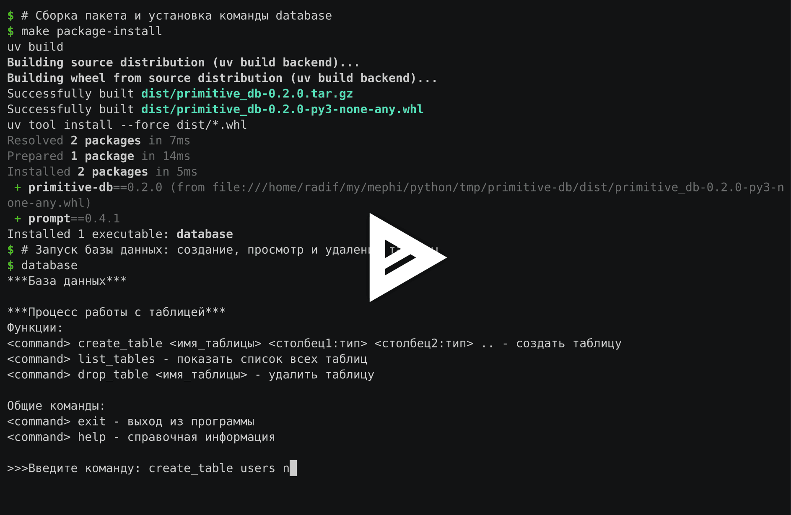
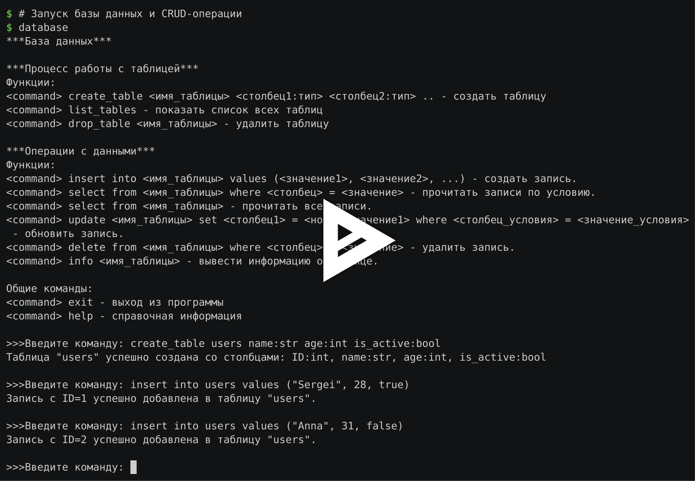
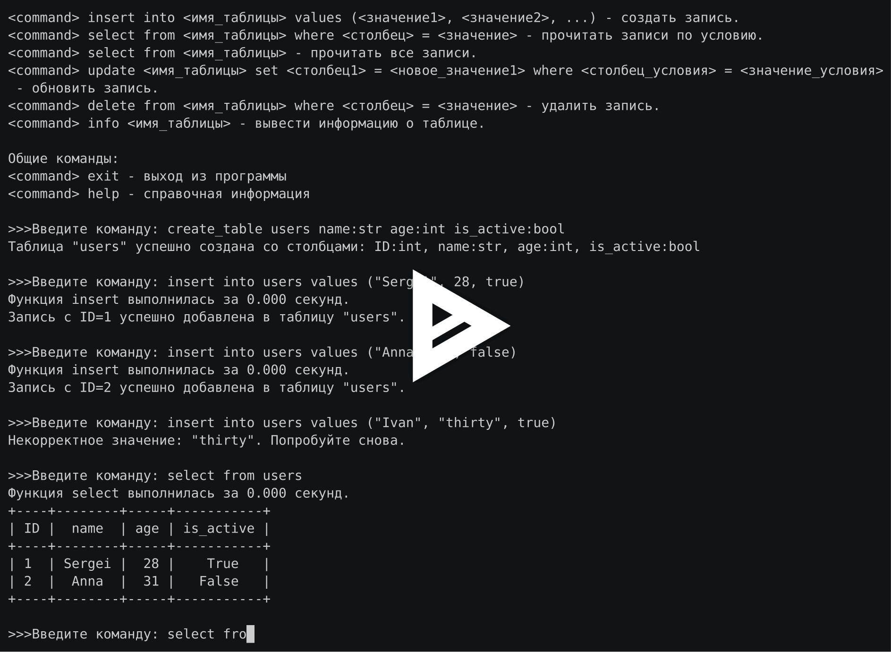

# primitive-db

Консольная СУБД на JSON-файлах с SQL-подобными командами.

[](https://github.com/radif-ru/primitive-db/actions/workflows/ci.yml)
[](https://www.python.org/)
[](https://docs.astral.sh/uv/)
[](https://docs.astral.sh/ruff/)
[](pyproject.toml)
[](https://asciinema.org/a/eoh2IgYzTu6bAajb)

Проект выполнен в рамках дисциплины «Программирование на Python» магистерской
программы [«Обработка данных и применение искусственного интеллекта»](https://eis2.mephi.ru/programs/Program/Details/1354)
(направление 01.04.02 «Прикладная математика и информатика»),
[Институт интеллектуальных кибернетических систем](https://icis.mephi.ru/)
[НИЯУ МИФИ](https://mephi.ru/).

## Задача

Интерактивная консольная база данных: пользователь создаёт таблицы с типизированными
столбцами и работает с записями командами, похожими на SQL (`insert`, `select`,
`update`, `delete` с условиями `where`). Схема таблиц и данные сохраняются в
JSON-файлах между запусками, результаты выборок выводятся таблицей.

## Принципы реализации

- Процедурный стиль без классов; модули разделены по ответственности (см. ниже).
- Из стандартной библиотеки — только `json`, `shlex`, `time`, `os`; внешние
  зависимости — `prompt` и `prettytable`, разработка — `ruff`.
- Все неизменяемые значения — пути, типы, ключевые слова, тексты сообщений —
  в `constants.py`; функции бросают `KeyError` / `ValueError` с готовым
  текстом, а выводит его единственный декоратор `handle_db_errors`.
- Разбор команд — на `shlex` в non-posix режиме: кавычки сохраняются, поэтому
  `"28"` — строка, `28` — число, а запятые и пробелы внутри строк не ломают разбор.
- Типы значений проверяются по схеме (`bool` не принимается за `int`), имя
  таблицы должно быть идентификатором — путь `data/<имя>.json` не выходит за
  пределы каталога.
- Аннотации типов (`type`-алиасы Python 3.12), docstring у каждой функции,
  doctest-примеры для парсера, бизнес-логики и декораторов.
- Ветвление по GitHub Flow, семантическое версионирование, проверки в CI.

## Архитектура

| Модуль | Ответственность |
|--------|-----------------|
| `main.py` | точка входа, консольная команда `database` |
| `engine.py` | основной цикл, диспетчеризация команд (`match`/`case`), вывод, кэш выборок |
| `core.py` | бизнес-логика: таблицы, CRUD, валидация типов |
| `parser.py` | разбор команд, значений, условий `where` и присваиваний `set` |
| `utils.py` | чтение и запись `db_meta.json` и `data/<таблица>.json` |
| `decorators.py` | `handle_db_errors`, `confirm_action`, `log_time`, `create_cacher` |
| `constants.py` | константы, `type`-алиасы и шаблоны сообщений |

## Установка и запуск

Нужен [uv](https://docs.astral.sh/uv/):

```bash
make install    # uv sync
make run        # uv run database
```

Установка как самостоятельной консольной команды:

```bash
make package-install    # uv build && uv tool install dist/*.whl
database
```

## Управление таблицами

| Команда | Действие |
|---------|----------|
| `create_table <имя_таблицы> <столбец1:тип> <столбец2:тип> ...` | создать таблицу |
| `list_tables` | показать список всех таблиц |
| `drop_table <имя_таблицы>` | удалить таблицу |
| `help` | справочная информация |
| `exit` | выход из программы |

Поддерживаемые типы столбцов: `int`, `str`, `bool`. Столбец `ID:int` добавляется
автоматически первым. Структура таблиц хранится в `db_meta.json` в текущем каталоге.

```text
>>>Введите команду: create_table users name:str age:int is_active:bool
Таблица "users" успешно создана со столбцами: ID:int, name:str, age:int, is_active:bool

>>>Введите команду: list_tables
- users

>>>Введите команду: drop_table users
Таблица "users" успешно удалена.
```

[](https://asciinema.org/a/8omJdzo0K0R1e4dL)

## CRUD-операции

| Команда | Действие |
|---------|----------|
| `insert into <имя_таблицы> values (<значение1>, <значение2>, ...)` | создать запись |
| `select from <имя_таблицы>` | прочитать все записи |
| `select from <имя_таблицы> where <столбец> = <значение>` | прочитать записи по условию |
| `update <имя_таблицы> set <столбец1> = <значение1>, ... where <столбец> = <значение>` | обновить записи |
| `delete from <имя_таблицы> where <столбец> = <значение>` | удалить записи |
| `info <имя_таблицы>` | вывести схему таблицы и число записей |

Значения передаются в синтаксисе литералов: строки — в кавычках (`"Sergei"`),
целые числа — как есть (`28`), логические — `true` / `false`. ID в `insert`
не указывается: он вычисляется как максимальный существующий ID + 1. Все
значения проверяются на соответствие типам столбцов. Записи каждой таблицы
хранятся в отдельном файле `data/<имя_таблицы>.json`, результат `select`
выводится таблицей [PrettyTable](https://github.com/prettytable/prettytable).

```text
>>>Введите команду: insert into users values ("Sergei", 28, true)
Запись с ID=1 успешно добавлена в таблицу "users".

>>>Введите команду: select from users where age = 28
+----+--------+-----+-----------+
| ID |  name  | age | is_active |
+----+--------+-----+-----------+
| 1  | Sergei |  28 |    True   |
+----+--------+-----+-----------+

>>>Введите команду: update users set age = 29 where name = "Sergei"
Запись с ID=1 в таблице "users" успешно обновлена.

>>>Введите команду: delete from users where ID = 1
Запись с ID=1 успешно удалена из таблицы "users".

>>>Введите команду: info users
Таблица: users
Столбцы: ID:int, name:str, age:int, is_active:bool
Количество записей: 0
```

[](https://asciinema.org/a/5B4s2QDzMWk2gCgi)

## Обработка ошибок, подтверждения и кэш

Повторяющаяся логика вынесена в `decorators.py`:

| Механизм | Где применяется | Что делает |
|----------|-----------------|------------|
| `@handle_db_errors` | `create_table`, `drop_table`, `insert`, `select`, `update`, `delete`, обработчик команд | перехватывает `KeyError`, `ValueError`, `FileNotFoundError` и выводит сообщение вместо трассировки |
| `@confirm_action("...")` | `drop_table`, `delete` | спрашивает `Вы уверены, что хотите выполнить "удаление таблицы"? [y/n]:` и отменяет операцию при любом ответе, кроме `y` |
| `@log_time` | `insert`, `select` | выводит `Функция select выполнилась за 0.000 секунд.` (`time.monotonic()`) |
| `create_cacher()` | `select` | замыкание со словарём-кэшем: повторный одинаковый запрос к неизменённой таблице не читает файл |

Кэш инвалидируется автоматически: в ключ входит версия данных таблицы, которая
растёт при каждом `insert`, `update`, `delete` и `drop_table`.

```text
>>>Введите команду: delete from users where ID = 2
Вы уверены, что хотите выполнить "удаление записи"? [y/n]: n
Операция отменена.
```

## Демонстрация

Полный цикл: установка пакета, создание таблицы, все CRUD-операции, ошибки
валидации, кэш выборок, подтверждение удаления и удаление таблицы.

[](https://asciinema.org/a/eoh2IgYzTu6bAajb)

## Проверки

```bash
make lint           # ruff check + ruff format --check
make test           # doctest для всех модулей пакета
make check-build    # uv build + twine check
```

Те же шаги и сквозной сценарий через stdin запускаются в
[GitHub Actions](.github/workflows/ci.yml) на каждый push и pull request.

## Структура проекта

```text
.
├── .github/
│   └── workflows/
│       └── ci.yml          # ruff, doctest, сборка пакета, сценарий CLI
├── docs/
│   └── images/             # превью записей asciinema
├── src/
│   └── primitive_db/
│       ├── __init__.py
│       ├── constants.py    # константы, типы, тексты сообщений
│       ├── core.py         # таблицы и CRUD-операции
│       ├── decorators.py   # декораторы и кэш на замыкании
│       ├── engine.py       # основной цикл и обработчики команд
│       ├── main.py         # точка входа
│       ├── parser.py       # разбор команд и условий
│       └── utils.py        # работа с JSON-файлами
├── .gitignore
├── .python-version         # закреплённая версия Python
├── Makefile                # install, run, lint, test, build, package-install
├── pyproject.toml          # метаданные пакета, зависимости, настройки ruff
├── README.md
└── uv.lock                 # зафиксированные версии зависимостей
```

Во время работы в текущем каталоге создаются `db_meta.json` и `data/` — они
исключены из репозитория через `.gitignore`.

---

Автор — [Радиф Илалтдинов](https://radif.ru)
